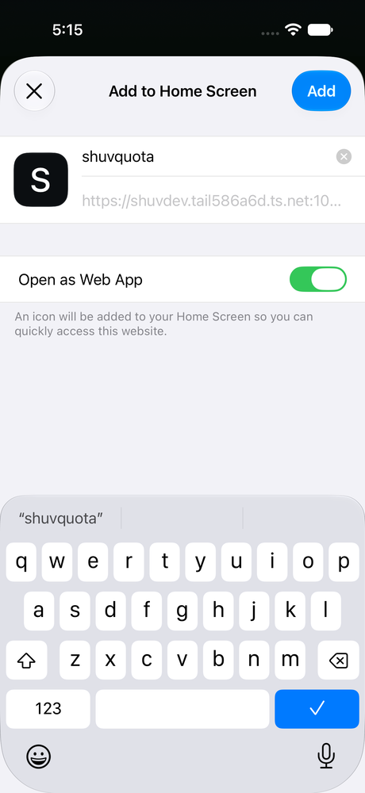
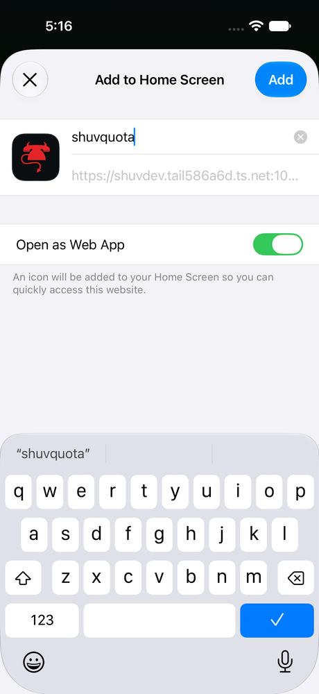
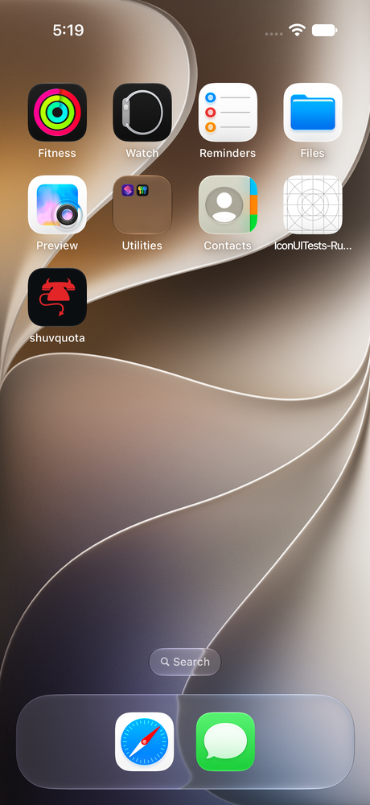

# iOS Home Screen icon investigation

Validated October 26, 2026, 5:08–5:21 PM PDT. The workaround is deployed at
`https://shuvdev.tail586a6d.ts.net:10008/`.

The user confirmed the fix worked on their physical iPhone on October 27, 2026
(PDT).

## Finding

The successful `NetworkingExtension` icon requests were from the Share sheet.
They did **not** establish that the Home Screen installer could retrieve an icon.
In an iOS 27.2 simulator, Add to Home Screen separately downloaded manifest
icons with a Safari user agent and touch icons with `SafariViewService`.
Those installer requests were absent from the captured physical-phone retry.

The existing assets and original security headers worked on a fresh simulator.
Changing ports, re-encoding the PNG, and removing CORP therefore did not establish
a fix for the reported failure. The earlier claim that differing JavaScript and
service-worker cache version numbers implied a mismatch was also unsupported;
those versions do not have to be equal.

## Controlled reproduction and fix

Tested with Safari in an iPhone 17 Pro simulator, iOS 27.2 (24B5089g), using
XCTest UI automation to open the actual Share and Add to Home Screen sheets.
A separate fixture server supplied an empty quota snapshot and the real static
assets and security headers. It returned 503 only for native installer image
requests, while ordinary page and `NetworkingExtension` requests still returned
200. The failure remained enabled throughout the comparison:

| Case | Add to Home Screen result |
| --- | --- |
| Original external touch/manifest icon URLs | Letter **S** |
| PNG embedded in the touch-icon link as a data URL | Red devil-phone icon |
| External fallback link followed by embedded link | Red devil-phone icon |
| Return to external-only version | Letter **S** again |
| Final production HTML, same injected native failures | Red devil-phone icon |

Pressed **Add** with native image downloads still failing. The installed WebClip's
`icon.png` was 180×180 RGB and pixel-identical to `web/icons/icon-180.png`
(ImageMagick absolute-error metric: **0 pixels**). `IconIsScreenShotBased` was
false. The icon appeared on the Home Screen and launched the standalone fixture
dashboard successfully.

Finally checked the real `:10008` deployment in the simulator after removing the
logging proxy and restoring direct Tailscale forwarding to `127.0.0.1:4789`.
Its Add to Home Screen sheet showed the correct icon with all original security
headers present.

## Implementation and maintenance

- `web/index.html` keeps the external Apple touch icon and adds an embedded PNG
  candidate, avoiding the installer's separate network dependency.
- `scripts/sync-pwa-icon.js` regenerates the embedded bytes and the conventional
  `/apple-touch-icon.png` fallback from `web/icons/icon-180.png`.
- After changing that PNG, run `bun scripts/sync-pwa-icon.js` and bump the service
  worker cache version. Manifest URLs and the precache list must refer to the
  same assets.
- `test/pwa-icon.test.js` checks the actual served HTML's decoded icon and root
  fallback against the source PNG, retaining the original security policies.
- Safari 26 introduced data-URL icon support:
  <https://webkit.org/blog/16993/news-from-wwdc25-web-technology-coming-this-fall-in-safari-26-beta/>.

## Validation and limits

- `bun test`: **737 passed, 0 failed**.
- `bun run release:pack`: passed; embedded HTML and root PNG included.
- `git diff --check`: passed.
- Initial pre-commit `bun run preflight`: package/file checks passed; the
  clean-tree check correctly rejected the uncommitted changes.
- This establishes a tested workaround for unavailable native icon downloads.
  The specific reason the physical phone's installer failed to reach the server
  is not established. Its networking component was a newer iOS 27.2 build than
  the available simulator. The user subsequently confirmed the fix on the
  physical phone; it was not directly inspected with device tooling.
